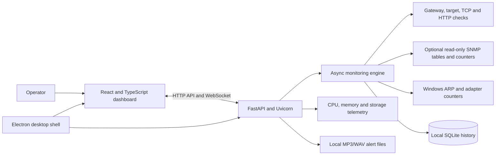

# Local Network Operations Monitoring Application

## Architecture, capabilities, and presentation guide

This document describes the current application implementation and provides a concise narrative for technical and management presentations. The repository currently packages the product as **BEL CyberNOC**; the technical description below is written for use with other organizations as well.

## Executive Summary

The application is a local-first monitoring dashboard for Windows. It checks configured network gateways, remote targets, and optional application endpoints; records availability and performance history; and presents incidents and alerts in a live operations view.

The application runs on the monitoring computer and stores its operational data locally. Its packaged desktop version combines an Electron user interface, a Python API and monitoring service, and a SQLite database. It does not require a cloud service or an external database for its core monitoring workflow.

## Business Need

Operations teams need a shared view of whether important network paths and services are responding, when an outage began, how it is progressing, and when service recovered. Checking devices individually can make it difficult to spot patterns or maintain a consistent incident record.

This application brings configured checks, recent history, status changes, and audible/visual alerts into one local dashboard. It is intended as an operational visibility tool, not a replacement for network-management platforms, packet analyzers, or a formal SLA measurement system.

## What the Application Monitors

- Gateway and remote-target reachability, checked independently.
- Round-trip latency and recent target packet-loss observations.
- Daily uptime estimate derived from recorded target-reachability samples.
- Optional TCP-port and HTTP(S) endpoint checks.
- RX/TX throughput from a configured SNMP interface, with monitoring-PC adapter counters as fallback.
- Optional observed-device counts using standard SNMP neighbor/bridge tables, with Windows ARP-cache fallback.
- Host computer CPU, memory, and storage usage.
- Down and recovery incidents, configurable thresholds, reminder alerts, and IST-dated CSV export.

## Technology Stack

| Area | Technology | Why it is used | Practical benefit |
| --- | --- | --- | --- |
| User interface | React 19 and TypeScript | Component-based interactive dashboard with typed data contracts | Live cards and settings can be changed without reloading the whole application; types help catch interface mismatches during development. |
| Frontend build | Vite 6 | Development server and optimized production bundling | Fast local development and static frontend files that can be packaged with the desktop application. |
| Visual components | Lucide React, Rajdhani, JetBrains Mono | Consistent icons and readable operational typography | Clear status-focused interface suited to a wall display or operations workstation. |
| Desktop shell | Electron 37 | Hosts the dashboard as a Windows desktop application | Provides a native window, fullscreen/kiosk behavior, startup integration, and controlled communication with desktop features. |
| Backend API | Python 3, FastAPI, Uvicorn | Serves dashboard data, authenticated configuration, audio, export, and WebSocket updates | One local service owns monitoring state and shares it with the interface in real time. |
| Configuration validation | Pydantic 2 | Validates monitor fields and SNMP settings at API boundaries | Invalid addresses, ranges, and incomplete settings are rejected before they reach the monitoring engine. |
| Network and host telemetry | Windows ICMP/TCP/HTTP checks, PySNMP, psutil | Uses OS probes, standard SNMP reads, and local system counters | Supports common connectivity checks and optional read-only network-device telemetry without requiring a cloud agent. |
| Persistence | SQLite | Stores samples, incidents, and reminder history locally | No separate database server is needed for a single-workstation deployment. |
| Windows packaging | PyInstaller, electron-builder, NSIS | Packages the Python service and creates a Windows installer | Produces an installable desktop distribution with bundled frontend/backend assets. |

## High-Level Architecture

## Frontend: What It Does

The frontend is a React single-page dashboard built with TypeScript and Vite. It presents:

- A live operations overview with one card per configured monitor.
- Current gateway/target state, RTT, packet-loss observation, uptime, throughput, and recent latency history.
- Incident history, system resource readings, and a simulation preview.
- Authenticated monitor configuration, audio mapping, and incident export controls.
- A floating visual alert synchronized with the queued down/recovery audio playback.

The interface receives snapshots and incident events through the local WebSocket feed. It uses HTTP for configuration, login, audio upload/test, and CSV export. The Electron preload bridge exposes only specific desktop actions; Node integration is disabled in the renderer.

## Backend: What It Does

The backend is a local FastAPI application served by Uvicorn. Its main responsibilities are:

1. Validate and persist monitor configuration.
2. Run asynchronous checks at each monitor's configured interval.
3. Apply failure and recovery thresholds to avoid declaring an incident from a single failed probe.
4. Write samples and incidents to SQLite.
5. Publish snapshots and state changes to connected dashboard clients.
6. Serve audio files, accept authenticated monitor/audio changes, and export incidents to CSV.

The monitoring engine maintains per-monitor state. Default monitor settings include a five-second interval, a 1.2-second timeout, three failures before down, and two successful checks before recovery; administrators can adjust supported settings.

## Monitoring Data and Interpretation

| Display or feature | Current data source | Interpretation and caveat |
| --- | --- | --- |
| Gateway and target status | ICMP probes | Tests reachability from the monitoring PC. Firewalls or devices that block ICMP can affect the result. |
| RTT | ICMP response timing | Measured from the monitoring PC; it is not a one-way delay measurement. |
| Packet loss | Recent target probe outcomes | A rolling observation based on recent checks, not a carrier-reported or end-to-end SLA measurement. |
| Daily uptime | Time-weighted recorded reachability samples | An estimate based on sampling; short failures between checks may not be observed. |
| TCP and HTTP(S) checks | Direct connection from the backend | The current HTTP(S) check does not use an explicit corporate proxy setting. Proxy-only egress may therefore require a future proxy-aware option. |
| RX/TX speed | SNMP IF-MIB counters, or local Windows adapter counters | SNMP measures the configured device interface. The fallback measures traffic through the monitoring PC, not total WAN traffic. |
| Observed device count | Standard IP-MIB/BRIDGE-MIB/Q-BRIDGE-MIB tables when enabled; otherwise Windows ARP cache | Best effort, deduplicated by MAC where SNMP tables are available. It is not guaranteed to represent every endpoint, DHCP lease, Wi-Fi client, or VLAN. |
| Host resources | psutil CPU, memory, and storage measurements | Describes the monitoring computer, not the remote router or monitored server. |

For a more authoritative enterprise device inventory, integrate the relevant DHCP server, wireless controller, router, or switch management API/table for each network segment. A generic ARP or standard-MIB view cannot guarantee complete device enumeration across all vendors and VLANs.

## Storage and Deployment

### Desktop runtime

- Electron starts the bundled backend and waits for its local health endpoint before showing the dashboard.
- The API binds to `127.0.0.1` by default.
- Packaged monitor configuration and SQLite data are stored under the current Windows user's Electron application-data directory.
- Packaged alert audio is stored under `C:\CyberNOC\audio`; the installer creates a Start Menu shortcut to that folder.
- The installer can optionally enable launch-at-sign-in and restart-after-closure behavior.
- Application logs are written to the Electron user-data directory as `backend.log`.

### Build and release

The Windows build process runs the frontend production build, packages the backend with PyInstaller, and creates an NSIS installer with electron-builder. The resulting installer is placed in `release`.

Development and build prerequisites are Windows 10/11, Python 3.11 or newer, and Node.js 20 or newer with npm. The packaged application bundles the frontend and backend, so end users do not need to run the development servers.

## Security and Operational Boundaries

- The intended default is a single local Windows workstation; API binding and route checks restrict access to loopback clients.
- Monitor configuration and audio-management routes require administrator authentication. Login attempts are rate-limited.
- Electron uses context isolation, a sandboxed renderer, and disabled Node integration.
- SNMP uses read-only SNMPv2c community access. SNMPv2c does not encrypt the community string; use it only on trusted management networks and restrict the community to read-only access.
- Monitoring should only be configured for systems and networks the organization is authorized to assess.
- The product is not currently configured for multi-user remote access, centralized fleet management, SSO, or proxy-aware HTTP checks.
- Retention, access to local configuration/database files, backup, and endpoint protection should be managed according to the organization's policies.

## Benefits to an Operations Team

- **Faster awareness:** status changes and alerts are visible in one place.
- **Consistent checks:** each line can use its own interval, timeout, thresholds, and optional application checks.
- **Useful incident context:** down/recovery times and recent telemetry are retained locally.
- **Low infrastructure overhead:** no cloud account or external database is required for the core single-site setup.
- **Flexible workstation deployment:** the application can run in a desktop window, fullscreen, or a kiosk-style display.
- **Incremental integration:** common SNMP counters and standard neighbor/bridge tables can be enabled where network equipment exposes them.

These are operational benefits, not guarantees of zero downtime, complete device discovery, or certified SLA measurement.

## Suggested Presentation Outline

### Slide 1: Operational Challenge

Explain the need for a consolidated view of line availability, service reachability, performance, and incidents.

### Slide 2: Application Overview

Introduce the local Windows dashboard and its focus on gateways, remote targets, application checks, incidents, and alerts.

### Slide 3: Architecture and Technology

Walk through the React/Vite frontend, Electron desktop shell, FastAPI monitoring service, Windows/network telemetry, and SQLite history.

### Slide 4: Live Monitoring Workflow

Show how configured probes run, thresholds create down/recovery transitions, and the backend publishes updates to the dashboard.

### Slide 5: Data, Alerts, and Reporting

Demonstrate monitor cards, synchronized visual/audio alerts, history, and IST-based incident CSV export.

### Slide 6: Deployment and Security

Describe the Windows installer, local storage, loopback binding, authenticated configuration, read-only SNMP, and authorized-use requirement.

### Slide 7: Scope and Next Steps

Explain the observed nature of device counts and local throughput fallback. Discuss organization-specific proxy support, authoritative DHCP/AP/switch inventory, centralized retention, and identity integration as optional future work.

## Short Presenter Script

> This application provides a local operations view of configured network lines and application endpoints. A Windows desktop shell hosts the dashboard and starts a Python monitoring service. The service runs gateway, target, and optional service checks, records history locally in SQLite, and streams incidents and status updates to the dashboard. Operators can configure thresholds, receive visual and audio alerts, review recent measurements, and export incident records. Optional read-only SNMP can provide interface counters and best-effort device observations when supported by the network equipment. The system is designed for authorized local monitoring; its observed counts and sampled uptime should be interpreted within their stated limits.

## Questions to Expect

**Does it need a cloud service?**

No. Core monitoring and history run locally. Initial development setup requires downloading dependencies; normal packaged runtime does not depend on a cloud service.

**Does the device count show every device?**

Not necessarily. It is an observed count from standard SNMP tables or the monitoring PC's ARP cache. Exact inventory may require DHCP, AP, router, or switch-specific integrations.

**Does throughput mean total internet bandwidth?**

Only when SNMP is configured to read the relevant router interface. The Windows fallback measures the monitoring PC's own adapter traffic.

**Can it monitor through a company proxy?**

The current HTTP(S) health check connects directly and has no explicit proxy configuration. Proxy-aware checking can be added if required by the organization's egress policy.

**Can it be deployed with another organization's branding?**

That requires checking the applicable project, commercial, trademark, and third-party asset terms and obtaining any required permissions. The current product name and logos should not be presented as an endorsement by another organization.

## Licensing and Branding Note
